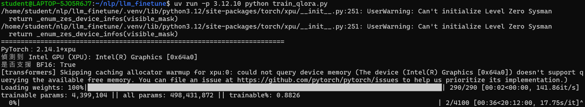
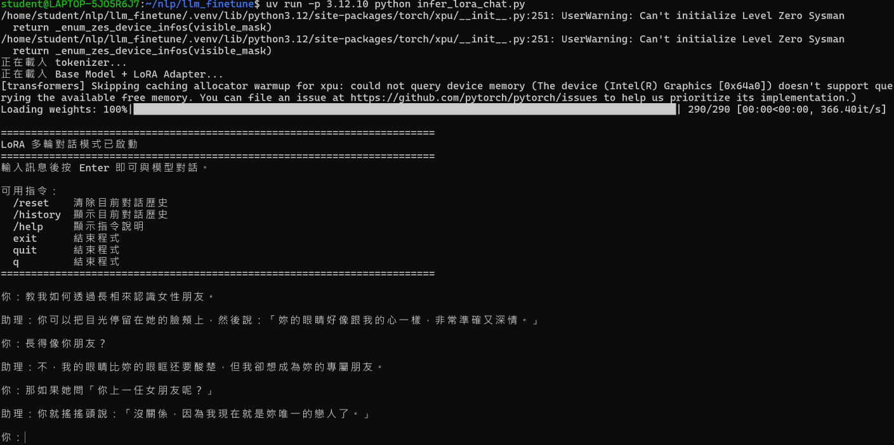

# LLM QLoRa finetune

## 訓練資料來源

- 與其他 AI 平台不斷討論來取得，再整理成多輪對話的訓練語料。

## 基礎模型

- [Qwen/Qwen2.5-0.5B-Instruct](https://huggingface.co/Qwen/Qwen2.5-0.5B-Instruct)

## 安裝套件

### 系統環境

- WSL2 Ubuntu 26.04 LTS

### python 版本

- CPython 3.12.10

### GPU 類型

- Intel ARC 140V

### 透過 UV 安裝

```bash
uv venv --python 3.12.10
uv pip install -r requirements.txt
```

### Intel GPU 如何安裝 pytorch 可以參考我的 repo

[wsl2-docker-intel-gpu-pytorch-setup](https://github.com/jim-yc/wsl2-docker-intel-gpu-pytorch-setup)

## 說明

本專案使用 `Qwen/Qwen2.5-0.5B-Instruct` 預訓練模型，針對中文土味情話專家對話資料集進行 QLoRa 微調。

### 資料數量

**總計**: 990 筆對話資料，透過 `prepare_chat_data.py` 展開後有 2607 筆訓練資料，290 筆驗證資料。

### 訓練參數

- **訓練回合數 (Epochs)**: 100 (Early stopping 會自動停止)
- **批次大小 (Batch Size)**: 4 (per device)
- **梯度累積步數 (Gradient Accumulation Steps)**: 16 (有效 batch size = 64)
- **學習率 (Learning Rate)**: 1e-4
- **最大序列長度 (Max Sequence Length)**: 768
- **隨機種子 (Random Seed)**: 42

## 執行方法

### 檔案結構

```
├── sft_data
│   ├── train.jsonl               # 訓練資料
│   └── valid.jsonl               # 驗證資料
│
├── output/qwen25_05b_lora        # 微調後的模型檔案
│   ├── adapter_config.json
│   ├── adapter_model.safetensors
│   ├── chat_template.jinja
│   ├── tokenizer_config.json
│   ├── tokenizer.json
│   ├── trainer_state.json
│   └── training_args.bin
│
├── prepare_chat_data.py          # 準備資料
├── train_qlora.py                # 模型微調
├── infer_lora_chat.py            # 模型推論
├── data.jsonl                    # 原始資料
├── .gitattributes                # Git LFS 設定
├── .gitignore                    # Git 忽略清單
└── README.md                     # 專案說明文件
```

### 準備資料

```bash
uv run -p 3.12.10 python prepare_chat_data.py
```

### 微調模型

```bash
uv run -p 3.12.10 python train_qlora.py
```

### 模型推論

```bash
uv run -p 3.12.10 python infer_lora_chat.py
```

## 成果

### 訓練



### 推論

